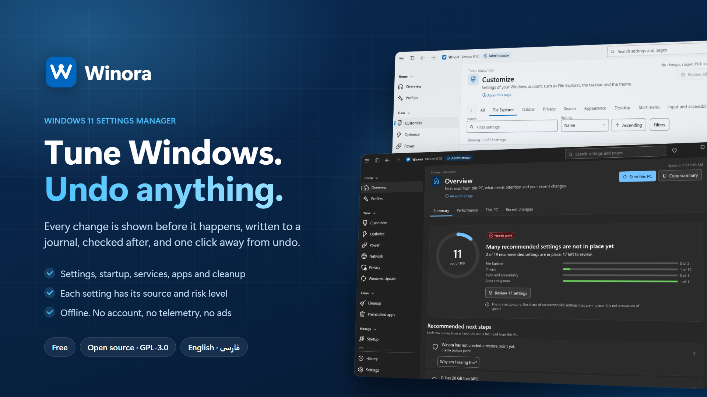
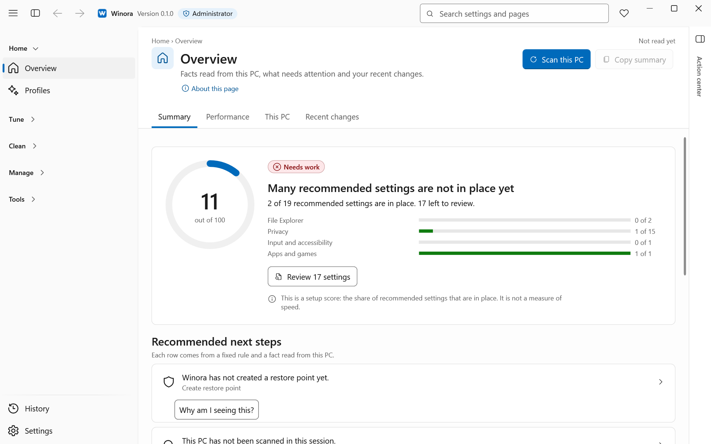
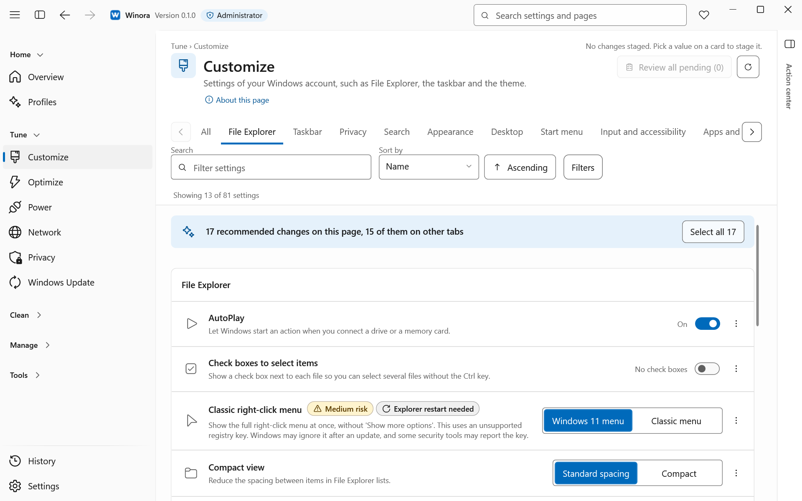

**English** · [فارسی](docs/translations/README.fa.md)

<div align="center">


# Winora

**Change Windows 11 settings with a review first and an undo after.**

A free, open-source settings manager for Windows 11.<br>
It runs on your PC only. No account, no telemetry, no ads.

[](https://enaloo.com/support/)

[](LICENSE)


[](https://github.com/ehsanenaloo/Winora/stargazers)

[Features](#features) · [Install](#install) · [How to use](#how-to-use-it) · [Privacy](#privacy-and-permissions) · [Safety](#built-to-be-safe) · [FAQ](#faq) · [Contributing](#contributing)

</div>



> **Status: 0.1.0 release candidate, unsigned, tested only on a Windows 11 virtual machine, not on real hardware.** Read [what Winora 0.x does and does not do](technical-docs/release-limits.md) before you run it.

## Why

Windows 11 spreads its settings over the Settings app, Control Panel, Group Policy, the registry, services and scheduled tasks. Changing them by hand means many places to look and no record of what you changed. Winora puts these settings on one set of pages. You see each change before it happens, and you can undo it later from History.

## Features

<picture>
  <source media="(prefers-color-scheme: dark)" srcset="docs/assets/screenshots/overview-dark.png">
  
</picture>

| | |
| --- | --- |
| **Settings with a source** <br> Customize, Optimize and Privacy list Explorer, taskbar, Start, performance and privacy settings. Each one has a risk level and the official page it is based on. | **Review before every change** <br> You see the value now, the value after, the exact location and the risk. Nothing changes until you confirm. |
| **Profiles** <br> Balanced, Speed, Security, Privacy, Gaming and Minimal. Each profile shows its full plan, applies after one confirmation and has one undo. | **History with Undo** <br> Every change Winora made is in History. Undo puts the old value back, unless something else changed it since. |
| **Apps, startup and background work** <br> Remove preinstalled apps and installed programs. Turn startup entries, scheduled tasks and services on or off. | **Clean up** <br> Free up space removes files Windows no longer needs. Disk usage shows what fills your drive. |
| **Power, network and updates** <br> Power plans and sleep options, DNS and adapters, and how Windows Update installs updates. | **Repair and features** <br> Run the built-in Windows repair tools and turn optional Windows features on or off. |
| **Action center** <br> Changes that wait for review, running tasks with Stop, and recent events. Open it with **Ctrl+Shift+A**. | **English and Persian** <br> Light and dark themes, accent colors and a full right-to-left layout. A command-line tool, `winora`, uses the same engine. |

<p align="center">
  
  &nbsp;
  
</p>

### What it changes

| Area | What Winora changes |
| --- | --- |
| Customize, Optimize, Privacy | Registry values for the current user and for the whole PC, from a fixed list |
| Power, Network, Windows Update | Power plans, DNS settings, Windows Update mode |
| Startup, Scheduled tasks, Services | Startup entries, tasks and services from a reviewed list |
| Preinstalled apps, Apps | Removes Store apps and installed programs. A removed program cannot be put back by Winora. |
| Cleanup | Files that Windows no longer needs |
| Repair and features | Built-in repair tools and optional Windows features |

The full lists are in the [settings catalog](technical-docs/settings-catalog.md) and the page documents in the [technical documentation](technical-docs/README.md).

## Install

There is no public release yet, and there is no download link or store listing. When releases come, they will be **unsigned** at first, so Windows SmartScreen will warn you. Read the [release limits](technical-docs/release-limits.md) for what to expect and how to check a download with its `SHA256SUMS` file.

### Build from source

You need Windows 11 x64, the .NET SDK 10.0.401 (pinned in `global.json`, later patches are allowed) and an internet connection for the first NuGet restore. Visual Studio is optional. Restore and build do not change Windows settings.

```powershell
dotnet restore Winora.slnx --locked-mode
dotnet build Winora.slnx -c Release --no-restore
dotnet run --project src/Winora.Desktop -c Release --no-build
dotnet run --project src/Winora.Cli -c Release --no-build -- --help
pwsh -File tools/publish.ps1 -SkipTests     # unsigned artifacts under dist/ (git-ignored)
pwsh -File tools/verify_dist.ps1            # checks them without installing anything
```

> **Warning:** the desktop app you build changes your real Windows settings when you confirm a change in it. Do that on purpose, and try it in a virtual machine first. The automated tests are kept in the development repository; the maintainer runs them before every release and pull request merge.

To run a build, install the **.NET 10 Desktop Runtime (x64)** first. Builds are framework-dependent, so the runtime is not included.

### Code signing policy

No release is signed yet, and each release says so. The plan, the rule for the publisher name and what signing does and does not prove are in [signing.md](technical-docs/signing.md). Report security problems privately as described in the [security policy](.github/SECURITY.md).

## How to use it


1. Start Winora and accept the administrator prompt. On the first start, a short guide offers a restore point and a profile.
2. Open a page, such as Customize, and change what you want. Your changes wait in the Action center.
3. Choose **Review changes** (or press **Ctrl+Enter**), check the list and confirm. To go back, open **History** and choose **Undo this change**.

## Privacy and permissions

- Winora runs as administrator. It needs these rights to change settings for the whole PC, services, scheduled tasks and installed programs. The command-line tool does not ask for these rights and changes only your own user settings.
- There is **no telemetry, no account, no ads, no auto-update and no network access of its own**. Nothing is sent anywhere.
- Your history and preferences stay on your PC, in `%ProgramData%\Winora` and `%LOCALAPPDATA%\Winora`.
- A diagnostics archive is made only when you choose **Settings > Export diagnostics**. Personal data is removed from it, and it is saved to a folder you pick. Read it before you share it.

## Built to be safe

Winora changes only items from a closed, reviewed list. It has no way to write a path or run a command that is not on that list. Every change follows the same steps:

- **Review** before the change, with the value now, the value after, the location and the risk.
- **Journal** written to disk before the change, so an interrupted change can be found and finished or rolled back.
- **Read-back** after the change, to check that Windows really kept the new value.
- **Undo** where an undo is possible. Undo refuses to overwrite a newer change made outside Winora, for example in the Windows Settings app.

Some changes cannot be undone, such as removing a program. The review says so before you confirm. Protected items are locked: Windows components, shared runtimes, hardware drivers, Winora itself, and services and tasks that are not safe to change. A setting that a Group Policy or MDM manages is not offered for change. Folders left behind by a removed program go to a quarantine, where you can restore them.

## FAQ

**Windows SmartScreen says "Windows protected your PC".** Release builds are not signed yet, so SmartScreen does not know them. Check the file against `SHA256SUMS` first. Do not bypass the warning on a PC you do not control. See [release limits](technical-docs/release-limits.md).

**Can I undo a change?** Yes, from the History page, for most changes. Undo stops if something else changed the value since. Removing an installed program and a few other changes cannot be undone; the review tells you before you confirm.

**What happens when I uninstall Winora?** Your Windows settings stay as they are. Uninstalling does not revert them. Winora's own data is kept, so History survives a reinstall. To get old values back, undo them from History before you uninstall.

**Does it work on Windows 10?** No. Winora supports Windows 11 only (build 22000 or later). Some settings need a newer build.

**Does it work on ARM64?** No. Only x64 is supported until ARM64 is tested.

**Is Winora made by Microsoft?** No. It is an independent project. Windows is a trademark of Microsoft.

## Documentation

| | |
| --- | --- |
| [Release limits](technical-docs/release-limits.md) | What 0.x does and does not do, SmartScreen, data, uninstall |
| [Settings catalog](technical-docs/settings-catalog.md) | Every per-user setting, its location and its source |
| [Security design](technical-docs/security.md) | Threat model and safety rules |
| [Code signing](technical-docs/signing.md) | Signing plan and policy |
| [Technical documentation](technical-docs/README.md) | Index of all design, test and release documents |
| [Changelog](CHANGELOG.md) | What changed |
| [Contributing](.github/CONTRIBUTING.md) | Setup, checks, settings, translations |
| [Security policy](.github/SECURITY.md) | How to report a vulnerability |

## Contributing

Bug reports, setting requests, translation fixes and small pull requests are welcome. Read [CONTRIBUTING.md](.github/CONTRIBUTING.md) first.

The Persian text is machine-drafted and has not had a native-speaker review. If you speak Persian natively, your review helps a lot. You can [open an issue](https://github.com/ehsanenaloo/Winora/issues/new/choose) or send a pull request. See [Translations](.github/CONTRIBUTING.md#translations).

If Winora saves you time, you can [support the project](https://enaloo.com/support/).

### Contributors

Thanks to everyone who has helped. Your name appears here after your first merged contribution.

<a href="https://github.com/ehsanenaloo/Winora/graphs/contributors"></a>

## License

[GPL-3.0-only](LICENSE) © 2026 [Ehsan Enaloo](https://github.com/ehsanenaloo). Third-party packages are listed in [THIRD-PARTY-NOTICES.md](THIRD-PARTY-NOTICES.md).
