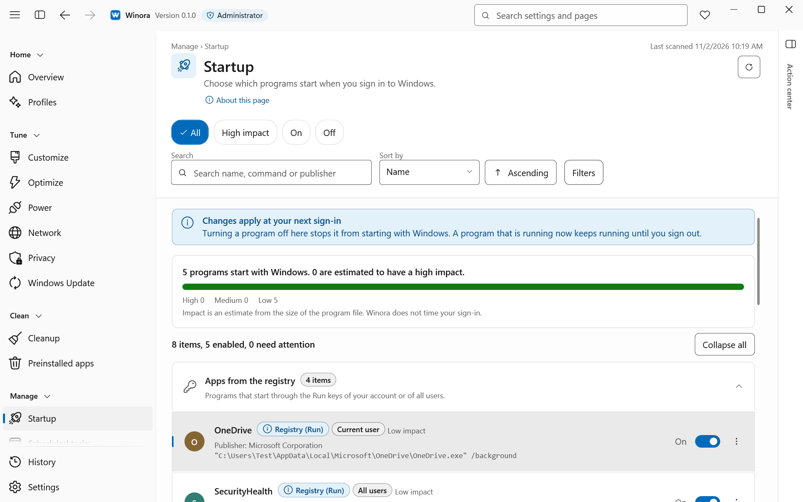
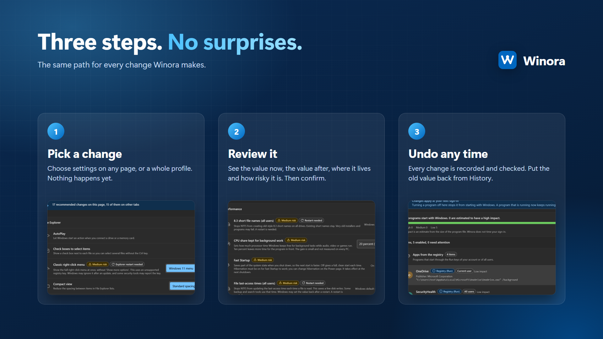

<div align="center">


# Winora

**Change Windows 11 settings with a review first and an undo after.**

A free, open-source settings manager for Windows 11.<br>
It runs on your PC only. No account, no telemetry, no ads.

[](https://enaloo.com/support/)

[](LICENSE)


[](https://github.com/ehsanenaloo/Winora/stargazers)

[Features](#features) · [Install](#install) · [How to use it](#how-to-use-it) · [Privacy](#privacy) · [Safety](#safety) · [FAQ](#faq) · [Contributing](#contributing)

</div>


## Why

Windows 11 keeps its settings in many places: the Settings app, Control Panel, Group Policy, the registry, services and scheduled tasks. Changing them by hand takes time, and you lose track of what you changed. Winora puts these settings on a few clear pages. You see each change before it happens, and you can undo it later.

## Features

<picture>
  <source media="(prefers-color-scheme: dark)" srcset=".github/assets/overview-dark.png">
  
</picture>

| | |
| --- | --- |
| **Settings in one place** <br> Customize, Optimize and Privacy cover File Explorer, the taskbar, Start, performance and privacy. Each setting shows its risk level. | **Review before every change** <br> You see the value now and the value after. Nothing changes until you confirm. |
| **Profiles** <br> Balanced, Speed, Security, Privacy, Gaming and Minimal. You see the full plan, confirm once, and undo it in one step. | **History with undo** <br> Every change Winora made is listed in History. Undo puts the old value back. |
| **Apps, startup and services** <br> Remove preinstalled apps and installed programs. Turn startup programs, scheduled tasks and services on or off. | **Cleanup** <br> Free up space and see what fills your drive. |
| **Power, network and updates** <br> Power plans, sleep options, DNS and how Windows Update installs updates. | **Repair and features** <br> Run the built-in Windows repair tools and turn optional features on or off. |
| **Action center** <br> Your waiting changes, running tasks and recent events in one panel. | **English and Persian** <br> Light and dark themes, accent colors and a full right-to-left layout. |

<p align="center">
  
  &nbsp;
  
</p>

## Install

Releases will be published on the [Releases](https://github.com/ehsanenaloo/Winora/releases) page.

You need Windows 11 (x64) and the .NET 10 Desktop Runtime.

### Build from source

You need the .NET 10 SDK.

```powershell
dotnet restore Winora.slnx --locked-mode
dotnet build Winora.slnx -c Release --no-restore
dotnet run --project src/Winora.Desktop -c Release --no-build
```

The app changes your real Windows settings when you confirm a change. Try it in a virtual machine first if you are not sure.

## How to use it



1. Start Winora and accept the administrator prompt. On the first start, a short guide offers a restore point and a profile.
2. Open a page, for example Customize, and pick the values you want. Your changes wait in the Action center.
3. Choose **Review changes** (or press **Ctrl+Enter**) and confirm. To go back, open **History** and choose **Undo this change**.

## Privacy

- Winora has no telemetry, no account, no ads and no auto-update. It sends nothing over the network.
- Your history and preferences stay on your PC.
- Winora runs as administrator because it changes settings for the whole PC, services, scheduled tasks and installed programs.

## Safety

- You see every change before it happens.
- Winora writes each change to its journal first, then checks that Windows kept the new value.
- Undo will not overwrite a value that something else changed after Winora.
- Windows components, drivers and other protected items are locked.
- When a change cannot be undone, such as removing a program, the review says so before you confirm.

## FAQ

**Can I undo a change?** Yes, from the History page. Removing a program cannot be undone, and the review says so first.

**What happens when I uninstall Winora?** Your Windows settings stay as they are. Undo the changes you want back from History before you uninstall.

**Does it work on Windows 10?** No. Winora is made for Windows 11.

**Is Winora made by Microsoft?** No. It is an independent project. Windows is a trademark of Microsoft.

## Contributing

Bug reports, setting requests, translation fixes and small pull requests are welcome. Read [CONTRIBUTING.md](.github/CONTRIBUTING.md) first. If you speak Persian, your help with the Persian text is very welcome.

If Winora saves you time, you can [support the project](https://enaloo.com/support/).

<a href="https://github.com/ehsanenaloo/Winora/graphs/contributors"></a>

## License

[GPL-3.0-only](LICENSE) © 2026 [Ehsan Enaloo](https://github.com/ehsanenaloo). Third-party packages are listed in [THIRD-PARTY-NOTICES.md](THIRD-PARTY-NOTICES.md).
