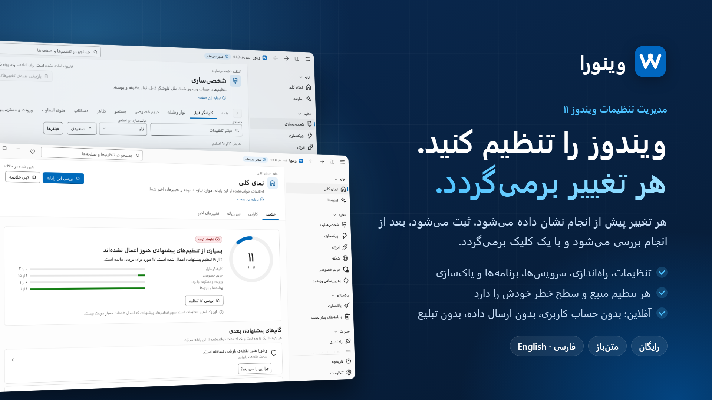
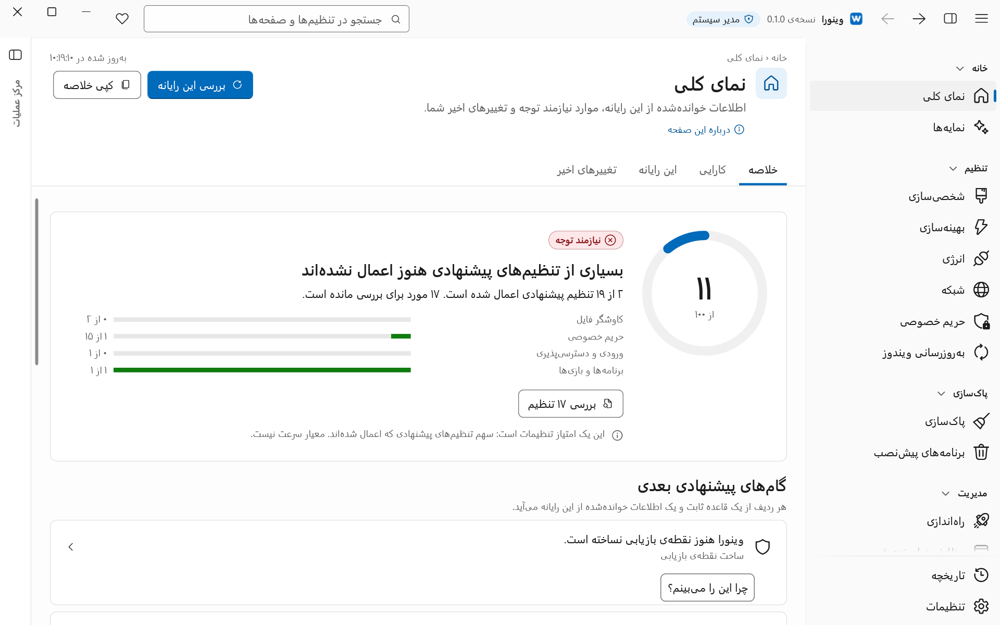
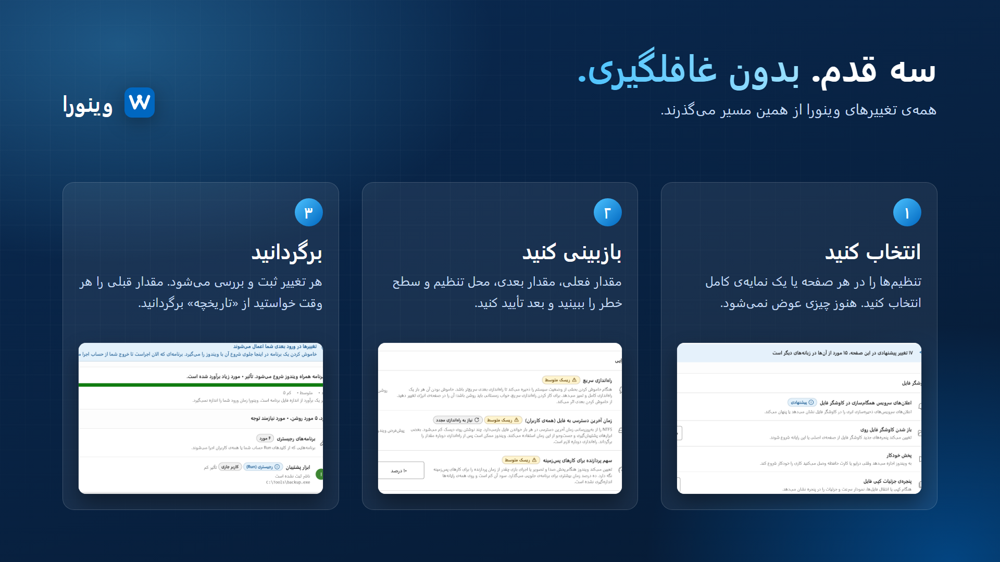

<div dir="rtl">

[English](../../README.md) · **فارسی**

<div align="center">


# Winora

**تنظیمات ویندوز ۱۱ را با بازبینی قبل از تغییر و امکان برگرداندن بعد از آن عوض کنید.**

برنامه‌ی رایگان و متن‌باز برای مدیریت تنظیمات ویندوز ۱۱.<br>
فقط روی رایانه‌ی خودتان اجرا می‌شود؛ بدون حساب کاربری، بدون ارسال داده، بدون تبلیغ.

[](https://enaloo.com/support/)

[](../../LICENSE)


[](https://github.com/ehsanenaloo/Winora/stargazers)

[امکانات](#امکانات) · [نصب](#نصب) · [طرز استفاده](#طرز-استفاده) · [حریم خصوصی](#حریم-خصوصی-و-دسترسی) · [ایمنی](#طراحی-ایمن) · [پرسش‌ها](#پرسش-و-پاسخ) · [مشارکت](#مشارکت)

</div>



> **وضعیت: نسخه‌ی نامزد انتشار `0.1.0`، بدون امضای دیجیتال، فقط روی یک ماشین مجازی ویندوز ۱۱ آزمایش شده و هنوز روی سخت‌افزار واقعی نه.** پیش از اجرا، [محدودیت‌های نسخه‌ی 0.x](../../technical-docs/release-limits.md) را بخوانید (انگلیسی).

## چرا؟

تنظیمات ویندوز ۱۱ در جاهای زیادی پخش است: برنامه‌ی Settings، کنترل پنل، Group Policy، رجیستری، سرویس‌ها و وظایف زمان‌بندی‌شده. اگر آن‌ها را دستی عوض کنید، باید جاهای زیادی را بگردید و هیچ سابقه‌ای از تغییرها نمی‌ماند. Winora این تنظیمات را در چند صفحه کنار هم می‌گذارد. هر تغییر را پیش از انجام می‌بینید و بعداً می‌توانید از صفحه‌ی «تاریخچه» آن را برگردانید.

## امکانات



- **تنظیمات با منبع:** صفحه‌های «شخصی‌سازی»، «بهینه‌سازی» و «حریم خصوصی» تنظیمات File Explorer، نوار وظیفه، منوی Start، کارایی و حریم خصوصی را نشان می‌دهند. هر تنظیم سطح خطر و منبع رسمی خودش را دارد.
- **بازبینی پیش از هر تغییر:** مقدار فعلی، مقدار بعدی، محل دقیق و سطح خطر را می‌بینید. تا تأیید نکنید، چیزی عوض نمی‌شود.
- **نمایه‌ها:** متعادل، سرعت، امنیت، حریم خصوصی، بازی و حداقلی. هر نمایه برنامه‌ی کاملش را نشان می‌دهد، با یک تأیید اعمال می‌شود و یک بار هم برمی‌گردد.
- **تاریخچه و برگرداندن:** هر تغییری که Winora داده در «تاریخچه» هست. برگرداندن مقدار قبلی را سر جایش می‌گذارد، مگر این‌که چیز دیگری از آن زمان آن را عوض کرده باشد.
- **برنامه‌ها و کارهای پس‌زمینه:** حذف برنامه‌های پیش‌نصب و برنامه‌های نصب‌شده، و روشن یا خاموش کردن موارد راه‌اندازی، وظایف زمان‌بندی‌شده و سرویس‌ها.
- **پاک‌سازی:** «آزادسازی فضا» فایل‌هایی را که ویندوز دیگر لازم ندارد پاک می‌کند و «مصرف دیسک» نشان می‌دهد چه چیزی درایو را پر کرده است.
- **انرژی، شبکه و به‌روزرسانی:** طرح‌های انرژی و خواب، DNS و کارت‌های شبکه، و این‌که به‌روزرسانی ویندوز چطور نصب شود.
- **تعمیر و ویژگی‌ها:** اجرای ابزارهای تعمیر خود ویندوز و روشن یا خاموش کردن ویژگی‌های اختیاری ویندوز.
- **مرکز عملیات:** تغییرهای منتظر بازبینی، کارهای در حال اجرا با دکمه‌ی توقف، و رویدادهای اخیر. با **Ctrl+Shift+A** باز می‌شود.
- **فارسی و انگلیسی:** پوسته‌ی روشن و تیره، رنگ تأکید و چیدمان کامل راست‌به‌چپ. ابزار خط فرمان `winora` هم از همان موتور استفاده می‌کند.

### چه چیزهایی را تغییر می‌دهد

| بخش | آنچه Winora تغییر می‌دهد |
| --- | --- |
| شخصی‌سازی، بهینه‌سازی، حریم خصوصی | مقدارهای رجیستری برای کاربر فعلی و برای کل رایانه، از یک فهرست ثابت |
| انرژی، شبکه، به‌روزرسانی ویندوز | طرح‌های انرژی، تنظیمات DNS، حالت به‌روزرسانی ویندوز |
| راه‌اندازی، وظایف زمان‌بندی‌شده، سرویس‌ها | موارد راه‌اندازی، وظایف و سرویس‌ها از یک فهرست بازبینی‌شده |
| برنامه‌های پیش‌نصب، برنامه‌ها | حذف برنامه‌های Store و برنامه‌های نصب‌شده. Winora برنامه‌ی حذف‌شده را برنمی‌گرداند. |
| پاک‌سازی | فایل‌هایی که ویندوز دیگر لازم ندارد |
| تعمیر و ویژگی‌ها | ابزارهای تعمیر خود ویندوز و ویژگی‌های اختیاری ویندوز |

## نصب

هنوز نسخه‌ی عمومی منتشر نشده و پیوند دانلود یا صفحه‌ای در فروشگاه وجود ندارد. نسخه‌های اول بدون امضای دیجیتال منتشر می‌شوند، پس SmartScreen ویندوز هشدار می‌دهد. در [محدودیت‌های نسخه](../../technical-docs/release-limits.md) آمده که چه انتظاری داشته باشید و چطور فایل دانلودشده را با `SHA256SUMS` بررسی کنید.

### ساختن از سورس

به ویندوز ۱۱ x64، ‏.NET SDK نسخه‌ی 10.0.401 (در `global.json` ثابت شده) و اینترنت برای اولین بازیابی بسته‌های NuGet نیاز دارید. Visual Studio لازم نیست. بازیابی و ساختن، تنظیمات ویندوز را تغییر نمی‌دهند.

<div dir="ltr">

```powershell
dotnet restore Winora.slnx --locked-mode
dotnet build Winora.slnx -c Release --no-restore
dotnet run --project src/Winora.Desktop -c Release --no-build
```

</div>

> **هشدار:** برنامه‌ای که خودتان می‌سازید، وقتی تغییری را در آن تأیید کنید، تنظیمات واقعی ویندوز شما را عوض می‌کند. این کار را آگاهانه انجام دهید و اول در یک ماشین مجازی امتحان کنید. آزمون‌های خودکار در مخزن توسعه نگه داشته می‌شوند و نگه‌دارنده‌ی پروژه آن‌ها را پیش از هر انتشار و هر ادغام اجرا می‌کند.

برای اجرا، اول **.NET 10 Desktop Runtime (x64)** را نصب کنید. این runtime همراه برنامه نیست.

## طرز استفاده



1. Winora را باز کنید و درخواست دسترسی مدیر را بپذیرید. بار اول، یک راهنمای کوتاه ساختن نقطه‌ی بازیابی و انتخاب نمایه را پیشنهاد می‌کند.
2. یک صفحه، مثلاً «شخصی‌سازی»، را باز کنید و چیزی را که می‌خواهید عوض کنید. تغییرها در «مرکز عملیات» منتظر می‌مانند.
3. «بررسی تغییرها» را بزنید (یا **Ctrl+Enter**)، فهرست را بررسی و تأیید کنید. برای برگرداندن، در «تاریخچه» گزینه‌ی «برگرداندن این تغییر» را بزنید.

## حریم خصوصی و دسترسی

- Winora با دسترسی مدیر اجرا می‌شود، چون برای تغییر تنظیمات کل رایانه، سرویس‌ها، وظایف زمان‌بندی‌شده و برنامه‌های نصب‌شده به آن نیاز دارد. ابزار خط فرمان این دسترسی را نمی‌خواهد و فقط تنظیمات کاربر خودتان را عوض می‌کند.
- **ارسال داده، حساب کاربری، تبلیغ، به‌روزرسانی خودکار و دسترسی شبکه‌ای از طرف خود برنامه وجود ندارد.** هیچ چیزی به جایی فرستاده نمی‌شود.
- تاریخچه و ترجیحات شما روی رایانه‌ی خودتان می‌ماند.
- بسته‌ی عیب‌یابی فقط وقتی ساخته می‌شود که خودتان در «تنظیمات» گزینه‌ی «ذخیره‌ی اطلاعات عیب‌یابی» را بزنید. اطلاعات شخصی از آن حذف می‌شود و در پوشه‌ای که خودتان انتخاب کنید ذخیره می‌شود. پیش از فرستادن، آن را بخوانید.

## طراحی ایمن

Winora فقط مواردی را تغییر می‌دهد که در یک فهرست بسته و بازبینی‌شده هستند. هر تغییر این مراحل را دارد:

- **بازبینی** پیش از تغییر، با مقدار فعلی، مقدار بعدی، محل و سطح خطر.
- **ثبت در دفتر** پیش از تغییر، تا اگر کار نیمه‌تمام ماند، پیدا و کامل یا برگردانده شود.
- **خواندن دوباره** بعد از تغییر، تا معلوم شود ویندوز مقدار تازه را واقعاً نگه داشته است.
- **برگرداندن** هر جا که ممکن باشد. اگر مقدار بعداً بیرون از Winora عوض شده باشد (مثلاً در برنامه‌ی Settings ویندوز)، Winora آن را بازنویسی نمی‌کند.

بعضی تغییرها، مثل حذف یک برنامه، برگشت‌پذیر نیستند و بازبینی پیش از تأیید این را می‌گوید. موارد محافظت‌شده قفل‌اند: اجزای ویندوز، runtimeهای مشترک، درایورهای سخت‌افزار، خود Winora، و سرویس‌ها و وظایفی که تغییرشان امن نیست. تنظیمی که Group Policy یا MDM آن را مدیریت می‌کند برای تغییر پیشنهاد نمی‌شود. پوشه‌هایی که از برنامه‌ی حذف‌شده می‌مانند به «قرنطینه» می‌روند و می‌توانید برشان گردانید.

## پرسش و پاسخ

**SmartScreen می‌گوید «Windows protected your PC».** نسخه‌ها هنوز امضای دیجیتال ندارند، پس SmartScreen آن‌ها را نمی‌شناسد. اول فایل را با `SHA256SUMS` بررسی کنید و روی رایانه‌ای که مال شما نیست از این هشدار نگذرید.

**می‌توانم تغییر را برگردانم؟** بله، برای بیشتر تغییرها از صفحه‌ی «تاریخچه». اگر مقدار از آن زمان جای دیگری عوض شده باشد، برگرداندن انجام نمی‌شود. حذف برنامه‌ی نصب‌شده و چند تغییر دیگر برگشت‌پذیر نیستند و بازبینی پیش از تأیید این را می‌گوید.

**اگر Winora را حذف کنم چه می‌شود؟** تنظیمات ویندوز همان‌طور می‌ماند و برگردانده نمی‌شود. داده‌های خود Winora هم می‌ماند تا تاریخچه بعد از نصب دوباره از دست نرود. اگر مقدارهای قبلی را می‌خواهید، پیش از حذف آن‌ها را از «تاریخچه» برگردانید.

**روی ویندوز ۱۰ کار می‌کند؟** نه. فقط ویندوز ۱۱ (بیلد ۲۲۰۰۰ به بعد) پشتیبانی می‌شود.

**روی ARM64 کار می‌کند؟** نه. تا وقتی آزمایش نشده، فقط x64 پشتیبانی می‌شود.

**Winora ساخته‌ی مایکروسافت است؟** نه. پروژه‌ای مستقل است. Windows نشان تجاری مایکروسافت است.

## مستندات

| | |
| --- | --- |
| [محدودیت‌های نسخه](../../technical-docs/release-limits.md) | کارهایی که نسخه‌ی 0.x می‌کند و نمی‌کند (انگلیسی) |
| [مستندات فنی](../../technical-docs/README.md) | فهرست همه‌ی سندهای طراحی، آزمون و انتشار (انگلیسی) |
| [تغییرات](../../CHANGELOG.md) | چه چیزهایی عوض شده (انگلیسی) |
| [راهنمای مشارکت](../../.github/CONTRIBUTING.md) | راه‌اندازی، بررسی‌ها، تنظیمات، ترجمه (انگلیسی) |
| [سیاست امنیتی](../../.github/SECURITY.md) | گزارش آسیب‌پذیری (انگلیسی) |

## مشارکت

گزارش خطا، درخواست تنظیم تازه، اصلاح ترجمه و Pull Requestهای کوچک را با خوشحالی می‌پذیریم. اول [CONTRIBUTING](../../.github/CONTRIBUTING.md) را بخوانید.

متن فارسی برنامه با ماشین نوشته شده و هنوز یک فارسی‌زبان آن را بازبینی نکرده است. اگر فارسی زبان مادری شماست، بازبینی شما خیلی کمک می‌کند. می‌توانید با فرم «Translation fix» یک [issue باز کنید](https://github.com/ehsanenaloo/Winora/issues/new/choose) یا Pull Request بفرستید.

اگر Winora در وقت شما صرفه‌جویی کرد، می‌توانید [از پروژه حمایت کنید](https://enaloo.com/support/).

## مجوز

[GPL-3.0-only](../../LICENSE) © ۲۰۲۶ [Ehsan Enaloo](https://github.com/ehsanenaloo)

</div>
